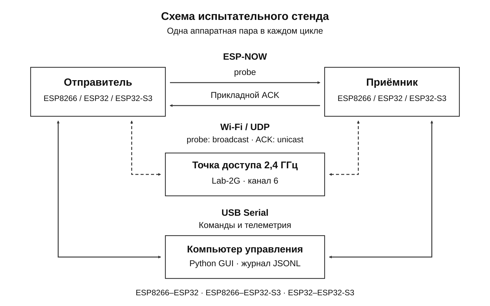
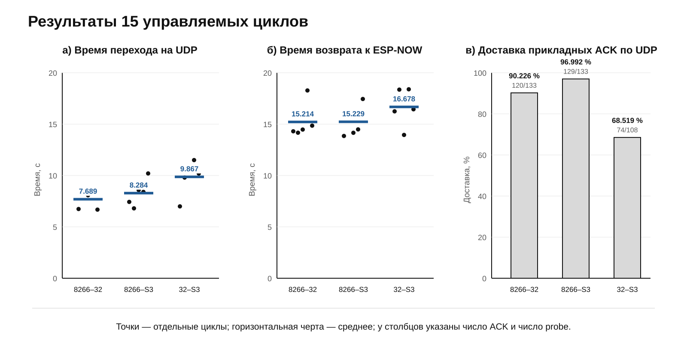
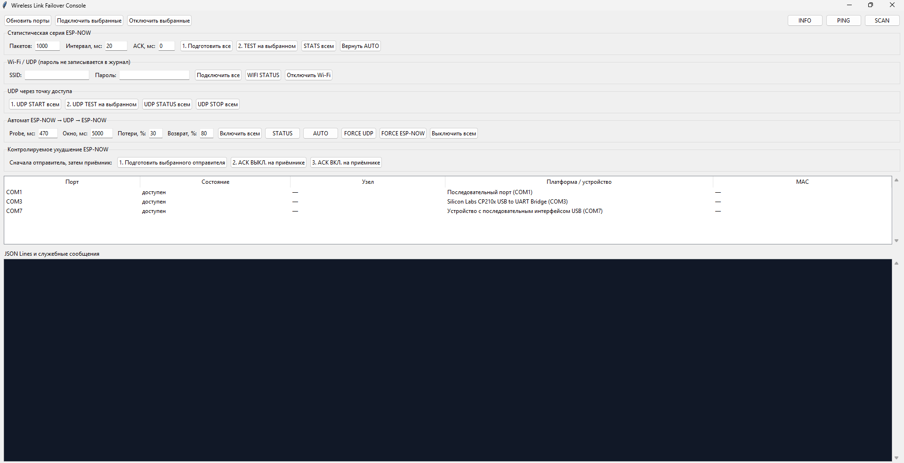

# Wireless Link Failover

[Русский](README.md) | [English](README_EN.md)

Программно-аппаратный стенд для проверки межпоколенческой совместимости ESP-NOW и автоматического резервного перехода на Wi-Fi/UDP. Испытаны ESP8266, ESP32 и ESP32-S3 во всех трёх попарных сочетаниях.

Основной транспорт передаёт короткие пакеты напрямую через ESP-NOW. При потере прикладных подтверждений автомат выбирает UDP через точку доступа, продолжает проверять ESP-NOW и возвращается к нему после восстановления. Оба транспорта используют один 20-байтовый пакет с `sequence`, временем работы отправителя и CRC32.

## Архитектура стенда



В каждом цикле активна одна аппаратная пара. ESP-NOW передаёт `probe` и прикладной `ACK` напрямую. Резервный UDP проходит через точку доступа. Компьютер управляет обеими платами по USB Serial и объединяет телеметрию в журнал JSON Lines. Третий узел в этот цикл не участвует.

## Результаты



Точки на первых двух графиках соответствуют отдельным циклам; горизонтальная черта показывает среднее. Для UDP указаны фактические числа полученных ACK и отправленных `probe`.

| Аппаратная пара | Переход и возврат | ESP-NOW до отказа | Среднее время перехода | Среднее время возврата | UDP ACK |
|---|---:|---:|---:|---:|---:|
| ESP8266–ESP32 | 5/5 | 308/308 | 7,689 с | 15,214 с | 120/133 (90,226 %) |
| ESP8266–ESP32-S3 | 5/5 | 193/193 | 8,284 с | 15,229 с | 129/133 (96,992 %) |
| ESP32–ESP32-S3 | 5/5 | 342/342 | 9,867 с | 16,678 с | 74/108 (68,519 %) |

Автомат выполнил переход и возврат во всех 15 циклах. Базовая доставка ESP-NOW составила 843/843 ACK. UDP доставил 323/374 ACK (86,364 %). Эти результаты подтверждают работу переключения, но не гарантированную доставку UDP: для надёжного резервного канала нужны повторы и дедупликация на прикладном уровне.

## Интерфейс управления



Настольное приложение обнаруживает последовательные порты, назначает отправителя и приёмник, задаёт параметры статистических серий и автомата, управляет контролируемым подавлением ACK и сохраняет служебные события. Пароль Wi-Fi передаётся только в оперативную память устройств и не записывается в журнал.

## Состав репозитория

- `firmware/` — общая прошивка и окружения PlatformIO для трёх плат;
- `desktop/` — приложение управления экспериментами и регистрации JSONL;
- `docs/` — спецификация протокола, методики и разбор результатов;
- `experiments/` — агрегированные данные, анализаторы и векторные графики;
- `article/` — рисунки и скрипты локальной сборки статей; готовые DOCX-файлы не публикуются.

## Сборка прошивки

Из каталога `firmware`:

```powershell
pio run -e node8266
pio run -e node32
pio run -e node32s3
```

Serial Monitor работает на скорости `115200` бод. Основные диагностические команды:

- `INFO`, `SCAN`, `PING`, `RADIO`, `STATS` — состояние узла и радиоканала;
- `TEST 1000 20` — серия из 1000 ESP-NOW `probe` с интервалом 20 мс;
- `WIFICONFIG <ssid>|<password>` — подключение к Wi-Fi без записи параметров во flash;
- `UDP START`, `UDP STOP`, `UDP STATUS`, `UDP TEST 1000 20` — управление резервным транспортом;
- `FAILOVER CONFIG 470 5000 30 80` — период `probe`, окно, порог потерь и порог восстановления;
- `FAILOVER ON`, `FAILOVER STATUS`, `FAILOVER OFF` — управление автоматом;
- `FAILOVER FORCE UDP|ESPNOW`, `FAILOVER AUTO` — ручная диагностика и возврат к автоматическому выбору.

Формат пакета приведён в [docs/PROTOCOL.md](docs/PROTOCOL.md), процедура повторения серий — в документах каталога [docs](docs/).

## Воспроизводимость и конфигурация

Агрегированные JSON содержат параметры серии и SHA-256 исходных снимков журналов. Локальные файлы `firmware/include/secrets.h` и сырые serial-журналы исключены через `.gitignore`. Опубликованные материалы используют нейтральное обозначение лабораторной сети и не содержат личных SSID или паролей.

## Лицензия

Проект распространяется по лицензии [MIT](LICENSE).
