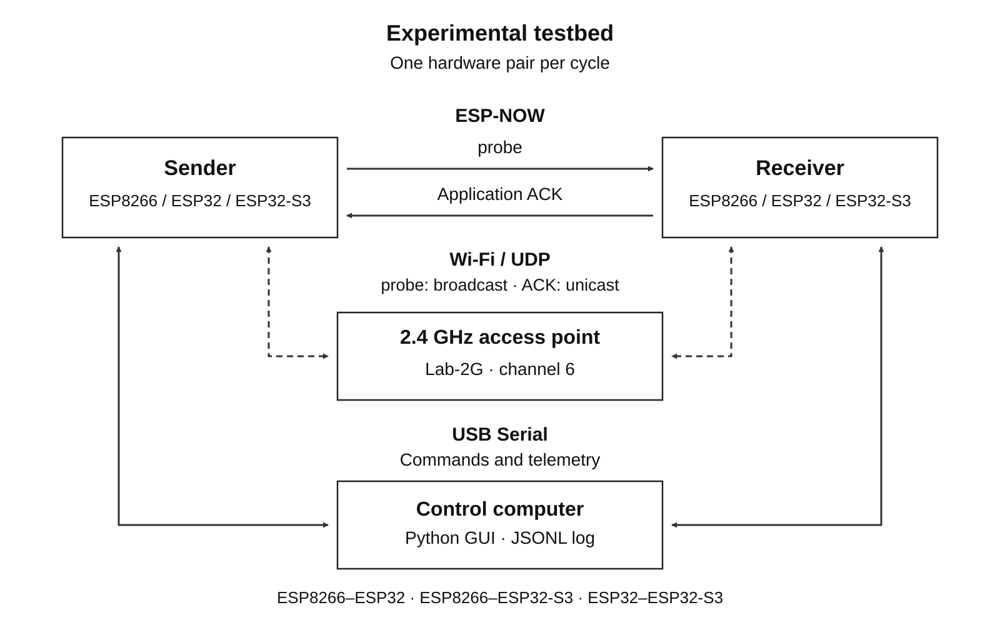
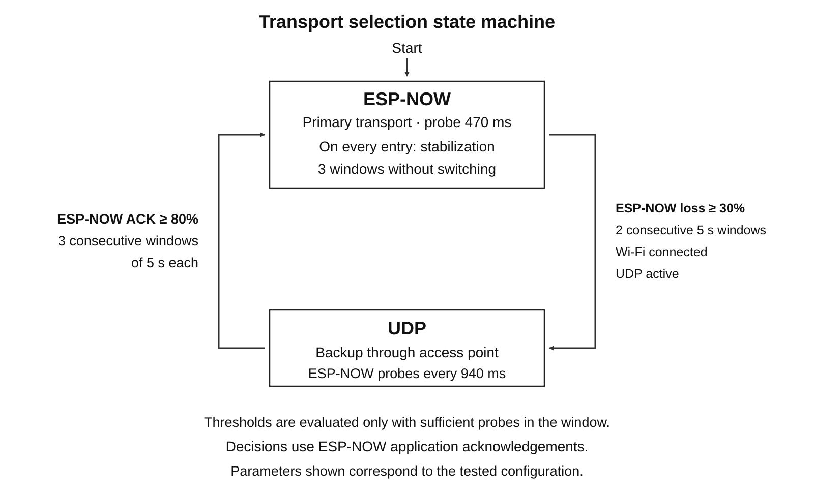
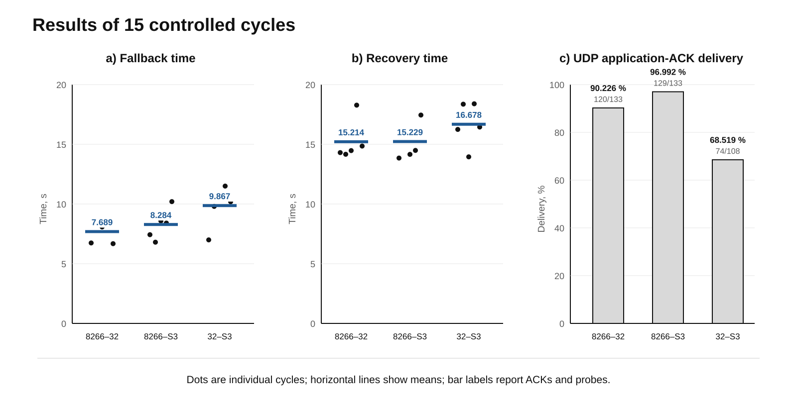
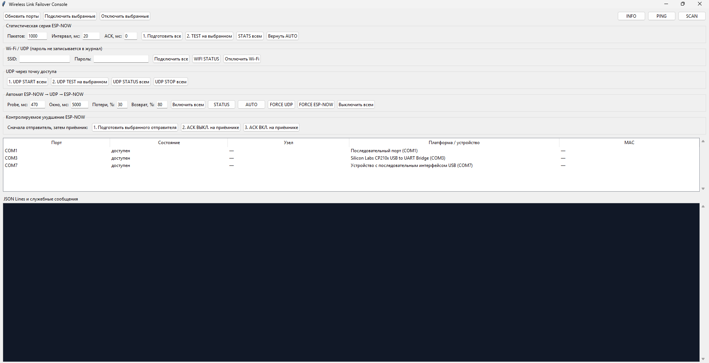

# Wireless Link Failover

[Русский](README.md) | [English](README_EN.md)

Wireless Link Failover is a hardware and software testbed for ESP-NOW interoperability across ESP device generations and automatic failover to Wi-Fi/UDP. The experiments cover ESP8266, ESP32 and ESP32-S3 in all three pairwise combinations.

The primary transport sends short packets directly over ESP-NOW. When application acknowledgements are lost, the state machine switches to UDP through an access point, continues probing ESP-NOW and returns to it after recovery. Both transports use the same 20-byte packet containing a sequence number, sender uptime and CRC32.

## Testbed architecture



One hardware pair is active in each cycle. ESP-NOW carries `probe` packets and application-level acknowledgements directly between the nodes. Backup UDP traffic passes through the access point. The control computer manages both boards over USB Serial and records their telemetry in a JSON Lines log. The third node does not participate in that cycle.

## Transport selection



Every entry into ESP-NOW includes three stabilization windows. Fallback requires two degraded windows, connected Wi-Fi and active UDP. Recovery requires three qualifying ESP-NOW windows. The diagram shows the tested configuration; loss of Wi-Fi separately forces a return to ESP-NOW.

## Results



Dots in the first two panels represent individual cycles; horizontal marks show the means. UDP bars report the actual number of received acknowledgements and transmitted `probe` packets.

| Hardware pair | Fallback and recovery | ESP-NOW before failure | Mean fallback time | Mean recovery time | UDP ACK |
|---|---:|---:|---:|---:|---:|
| ESP8266-ESP32 | 5/5 | 308/308 | 7.689 s | 15.214 s | 120/133 (90.226%) |
| ESP8266-ESP32-S3 | 5/5 | 193/193 | 8.284 s | 15.229 s | 129/133 (96.992%) |
| ESP32-ESP32-S3 | 5/5 | 342/342 | 9.867 s | 16.678 s | 74/108 (68.519%) |

The state machine completed fallback and recovery in all 15 cycles. Baseline ESP-NOW delivery was 843/843 acknowledgements. UDP delivered 323/374 acknowledgements (86.364%). These results demonstrate transport switching, but they do not establish reliable UDP delivery; a production backup channel requires application-level retransmission and deduplication.

## Control interface



The desktop application discovers serial ports, assigns sender and receiver roles, configures statistical runs and failover thresholds, controls deliberate acknowledgement suppression and records service events. The Wi-Fi password is sent only to device RAM and is not written to the log.

## Repository layout

- `firmware/` - shared firmware and PlatformIO environments for the three boards;
- `desktop/` - experiment control and JSONL logging application;
- `docs/` - protocol specification, experimental procedures and result analysis;
- `experiments/` - aggregate data, analysis scripts and vector plots;
- `article/` - figures and scripts for local article builds; generated DOCX files are not published.

## Firmware build

Run from the `firmware` directory:

```powershell
pio run -e node8266
pio run -e node32
pio run -e node32s3
```

The serial interface operates at `115200` baud. Main diagnostic commands:

- `INFO`, `SCAN`, `PING`, `RADIO`, `STATS` - inspect node and radio state;
- `TEST 1000 20` - send 1,000 ESP-NOW `probe` packets at 20 ms intervals;
- `WIFICONFIG <ssid>|<password>` - connect to Wi-Fi without storing credentials in flash;
- `UDP START`, `UDP STOP`, `UDP STATUS`, `UDP TEST 1000 20` - control the backup transport;
- `FAILOVER CONFIG 470 5000 30 80` - set the probe period, observation window, loss threshold and recovery threshold;
- `FAILOVER ON`, `FAILOVER STATUS`, `FAILOVER OFF` - control the failover state machine;
- `FAILOVER FORCE UDP|ESPNOW`, `FAILOVER AUTO` - select a transport for diagnostics or restore automatic selection.

The packet format is documented in [docs/PROTOCOL.md](docs/PROTOCOL.md). Repetition procedures and experimental notes are available in the [docs](docs/) directory.

## Reproducibility and configuration

Aggregate JSON files include run parameters and SHA-256 hashes of the source log snapshots. Local `firmware/include/secrets.h` files and raw serial logs are excluded through `.gitignore`. Published materials use a neutral laboratory network identifier and contain no personal SSIDs or passwords.

## License

This project is distributed under the [MIT License](LICENSE).
