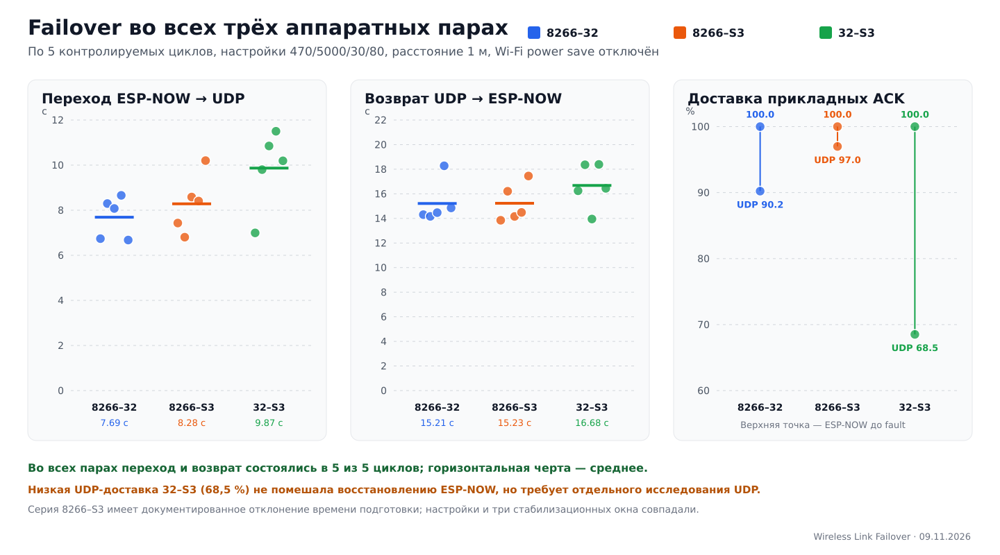

# Итоговая матрица автоматического переключения

## Область эксперимента

Автоматический переход ESP-NOW → Wi-Fi/UDP и обратный возврат проверены на
всех трёх аппаратных парах стенда:

- ESP8266 ↔ ESP32;
- ESP8266 ↔ ESP32-S3;
- ESP32 ↔ ESP32-S3.

Для итогового сравнения использовалась одинаковая конфигурация автомата:
период probe 470 мс, окно 5000 мс, порог перехода 30 %, порог возврата 80 %,
два плохих и три хороших окна, recovery probe 940/470 мс. Энергосбережение
Wi-Fi отключено. Платы располагались примерно в 1 м друг от друга и работали
через сеть `Lab-2G` на канале 6.

## Результаты

| Аппаратная пара | Переход/возврат | Базовые ACK ESP-NOW | Среднее время перехода, с | Среднее время возврата, с | ACK резервного UDP |
|---|---:|---:|---:|---:|---:|
| ESP8266 ↔ ESP32 | 5/5 | 308/308 (100 %) | 7,689 | 15,214 | 120/133 (90,226 %) |
| ESP8266 ↔ ESP32-S3 | 5/5 | 193/193 (100 %) | 8,284 | 15,229 | 129/133 (96,992 %) |
| ESP32 ↔ ESP32-S3 | 5/5 | 342/342 (100 %) | 9,867 | 16,678 | 74/108 (68,519 %) |

Всего выполнено 15 контролируемых циклов. Автоматический переход на UDP и
возврат на ESP-NOW состоялись в 15/15 случаях. До внесения отказа получено
843/843 прикладных ACK ESP-NOW. Среднее время перехода по всем циклам равно
8,613 с, медиана — 8,405 с; среднее время возврата равно 15,707 с, медиана —
14,851 с. В финальных окнах восстановления получено 232/240 ACK (96,667 %).

## Серия ESP32 ↔ ESP32-S3

В этой серии блокировка GUI выдерживала 30-секундный интервал перед
подавлением ACK. По временным меткам устройства зарегистрировано
29,691–48,943 с. Нижнее значение на 309 мс меньше из-за последовательной
обработки команд и различия временных шкал GUI и платы; анализ допускает
только 1 с такой погрешности и дополнительно требует не менее пяти полностью
завершённых базовых окон. Все пять циклов соответствуют этому критерию.

| Направление отправителя | Повторов | Среднее время перехода, с | Среднее время возврата, с | ACK резервного UDP |
|---|---:|---:|---:|---:|
| ESP32 → ESP32-S3 | 3 | 9,562 | 17,027 | 45/71 (63,380 %) |
| ESP32-S3 → ESP32 | 2 | 10,324 | 16,154 | 29/37 (78,378 %) |

Пониженная доставка UDP в этой паре не препятствовала работе автомата: после
восстановления ESP-NOW получено 79/80 ACK, и возврат состоялся во всех пяти
циклах. Однако результат 74/108 показывает, что текущий UDP-транспорт нельзя
считать транспортом с гарантированной доставкой. Для такой гарантии нужны
повторная передача, нумерация пакетов, подтверждения и ограничение очередей.

## Ограничения интерпретации

Серия ESP8266 ↔ ESP32-S3 выполнялась до добавления 30-секундной блокировки
GUI: отказ в ней включался через 16,284–26,429 с, хотя перед ним во всех опытах
завершились три стабилизационных окна со 100 % ACK. Поэтому корректно
утверждать, что алгоритм воспроизводимо сработал на всех трёх парах при одной
конфигурации, но нельзя интерпретировать небольшие различия времени как
чистый эффект типа микроконтроллера.

Данные получены на одном комплекте плат, одном роутере, одном расстоянии и в
одной радиосреде. Они не доказывают устойчивость при препятствиях, иной
загрузке канала, других экземплярах плат или одновременной работе трёх
отправителей.

Научно корректный итоговый вывод:

> Разработанный автомат выбора транспорта обеспечил воспроизводимый переход
> с ESP-NOW на UDP и обратное восстановление на всех трёх исследованных
> аппаратных парах в 15 из 15 контролируемых циклов. При этом качество
> резервной UDP-доставки зависело от пары и направления, поэтому механизм
> переключения подтверждён, а надёжность UDP требует отдельного улучшения и
> расширенной серии испытаний.

## Воспроизводимые материалы

- анализ ESP32 ↔ ESP32-S3:
  `python experiments/analyze_standardized_32_s3_series.py`;
- итоговая матрица и рисунок:
  `python experiments/analyze_all_pairs_matrix.py`;
- машинная сводка серии:
  `experiments/results/failover_32_s3_standardized_5x_20261109_summary.json`;
- общая машинная матрица:
  `experiments/results/failover_all_pairs_20261109.json`;
- SHA-256 стабильного снимка исходного журнала ESP32 ↔ ESP32-S3:
  `ca4ec6ad2b9ad72898658359a07fcec3b2fd3730a1cc9c06f6aef8b2e24eb2cb`.

Сырой журнал намеренно не включён в Git из-за размера; хеш в сводке связывает
опубликованные результаты с неизменяемым локальным снимком.
